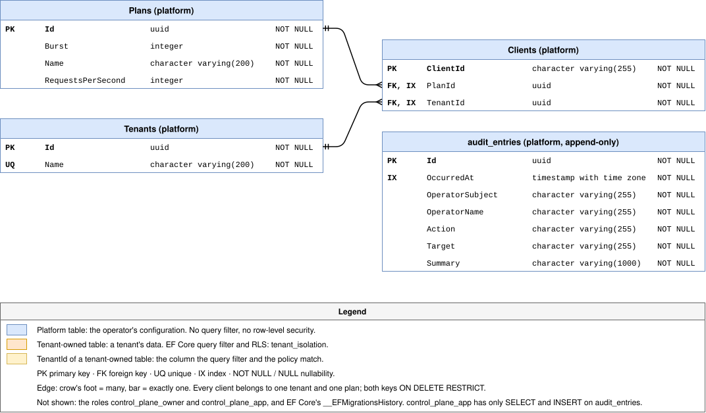
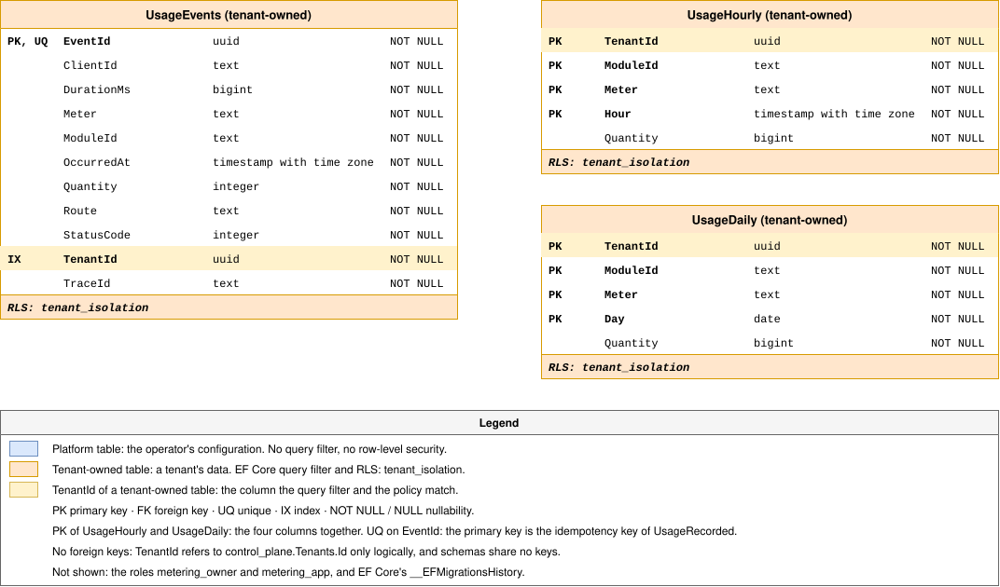

# Data model

How Homeport keeps its data in PostgreSQL, and why a table is either
tenant-owned or a platform table. The binding rules are in the *Tech stack*
and *Multi-tenancy* sections of [`AGENTS.md`](../../AGENTS.md#multi-tenancy);
the decision is [ADR-0005](adr/0005-persistence-and-multi-tenancy.md).

## One database, one schema per service

Homeport keeps everything in one database, `homeport`. Each service that
stores data owns one schema in it and nothing outside it:

| Service | Schema | Tables |
|---|---|---|
| Control plane | `control_plane` | `Tenants`, `Plans`, `Clients`, and EF Core's `__EFMigrationsHistory` |
| Metering | `metering` | `UsageEvents`, `UsageHourly`, `UsageDaily`, and EF Core's `__EFMigrationsHistory` |

Each schema comes with two roles, which
[`deploy/postgres/init/init-homeport.sh`](../../deploy/postgres/init/init-homeport.sh)
creates:

- **`<schema>_owner`** owns the schema and runs the migrations. It is the only
  role with DDL rights on it.
- **`<schema>_app`** is what the service connects as. It may read and write
  the tables of its schema, and nothing else: it cannot create, alter or drop
  a table, and it sees no other service's schema.

A service never migrates its own database at start. Its image has a second
entry point, `migrate`, that runs once as the owner role, applies the pending
migrations and seeds what the service needs, and exits; the service starts
only after it completed. A bug or a compromise in a running service
therefore cannot change the schema, and an operator sees a failed migration
as a failed step, not as a service that does not come up.

The setup of schemas and roles is SQL only PostgreSQL understands. It is the
one place besides row-level security where Homeport's data access is not
provider-neutral, and it is kept in the init script rather than in the
migrations, because creating a role needs rights no service holds.

## Tenant-owned and platform tables

A table is one of two kinds:

- **Tenant-owned.** Its rows are a tenant's data: what the tenant did or
  stored, such as the usage events metering records. Every row carries a
  `TenantId`, and two independent layers keep tenants apart: EF Core global
  query filters, and PostgreSQL row-level security driven by the session
  setting `homeport.tenant_id`. If one layer has a bug, the other still
  holds. Metering's three tables are the tenant-owned tables so far; see
  [Row-level security](#row-level-security) below.
- **Platform tables.** The operator's own configuration of the installation:
  which tenants exist, which plans, which clients belong to which tenant. No
  tenant reads them, and the services that read them — the gateway, through
  the control plane — read them for every tenant alike. They have no query
  filter and no row-level security, even where a row names a tenant, as
  `Clients` does.

The distinction is made per table, by asking whose data its rows are. A
table whose rows a tenant created is tenant-owned, even if the operator also
reads it.

## Row-level security

Every tenant-owned table has the policy `tenant_isolation`, created by a
migration: a row is visible, and may be written, only when its `TenantId`
equals the session setting `homeport.tenant_id`. An empty or missing setting
matches no row, so a connection that names no tenant reads nothing and
writes nothing.

The service sets the setting on every connection it opens, through an EF
Core interceptor, to the tenant its current unit of work is for, and the
query filters read the same tenant. Metering works for the tenant of the
event it records. The policies bind the app role; PostgreSQL exempts a
table's owner, so `migrate` is not held to them.

Every feature that touches tenant data has a cross-tenant leakage test:
with tenant A set, no query returns a row of tenant B, through EF Core with
and without the query filters and through raw SQL as the app role.

## Schemas

One diagram per schema, drawn from the service's EF Core model snapshot. Both
files are draw.io diagrams: open them in draw.io to edit them, and export
them again uncompressed. A migration updates its schema's diagram in the same
pull request.

### `control_plane`

Each table lists its columns with type and nullability; an edge runs from a
foreign key to the key it refers to, the crow's foot on the many side.

### `metering`

The same notation; the three tables share no foreign key, and `TenantId`
refers to `control_plane.Tenants` only logically.

