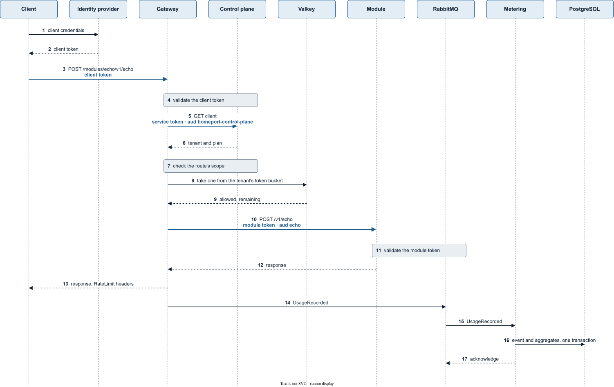
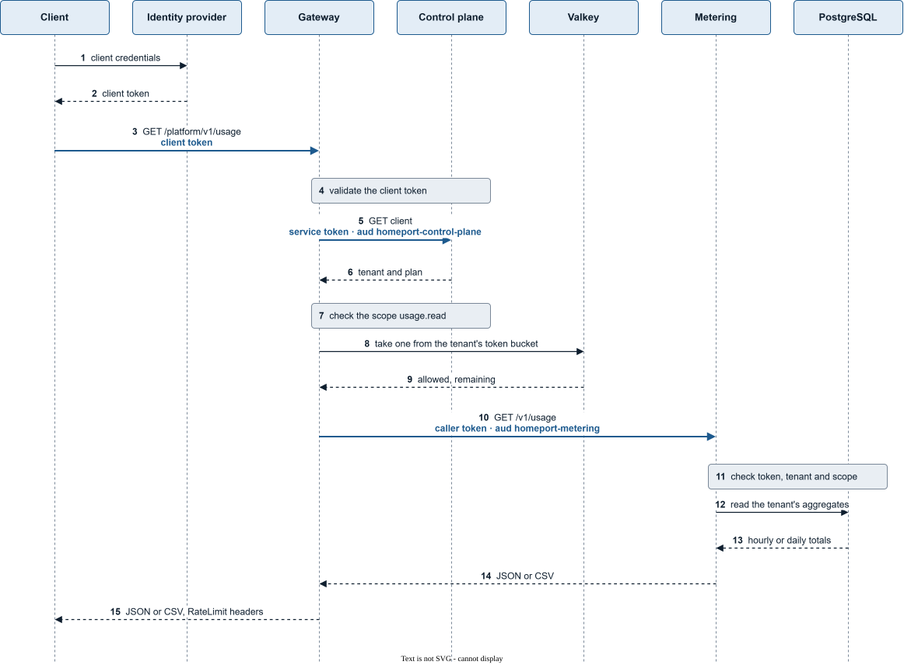
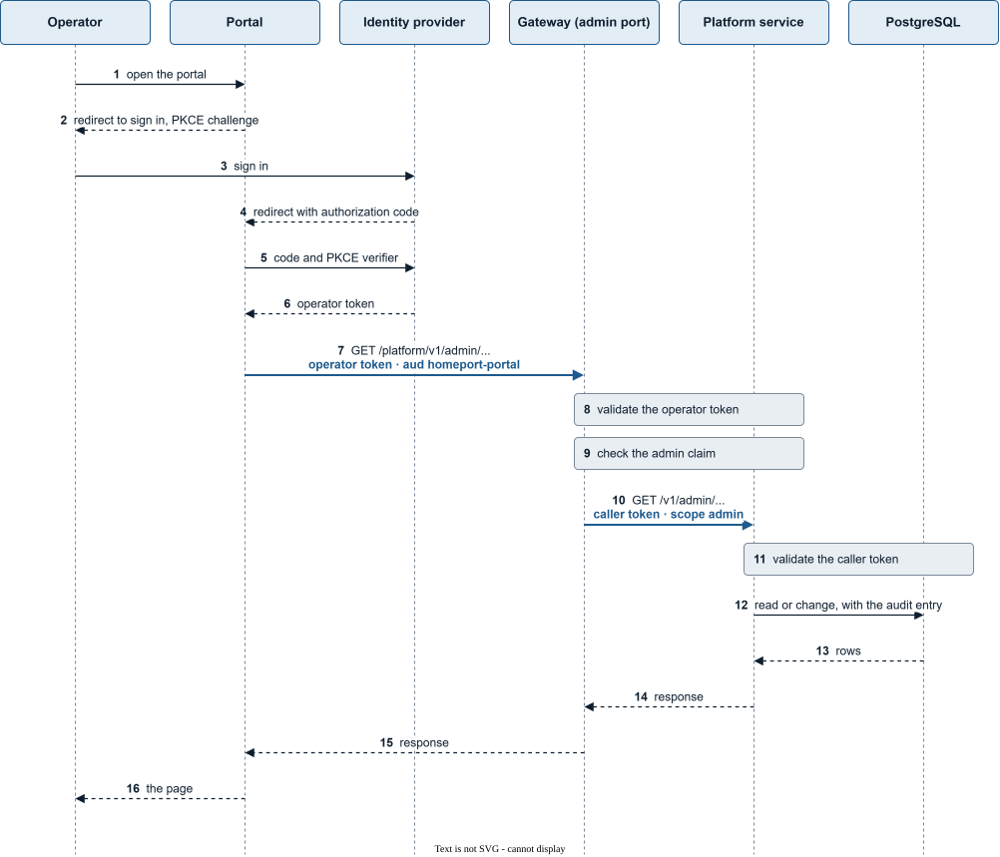

# Request flow

How a request travels through Homeport, step by step: a call to a module,
a platform request that a platform service answers, and an admin request
of the operator. Each flow is one
sequence diagram of the successful path, followed by what can fail at each
step and how Homeport answers it. The decisions behind it are
[ADR-0011](adr/0011-gateway-issued-tokens-for-modules.md) (module tokens),
[ADR-0014](adr/0014-authentication-between-services.md) (service tokens) and
[ADR-0019](adr/0019-tokens-for-forwarded-platform-requests.md) (caller
tokens) and [ADR-0020](adr/0020-the-operator-as-a-caller.md) (the operator);
the binding rules are in the *Gateway* and *Service-to-service*
sections of [`AGENTS.md`](../../AGENTS.md#gateway).

Every arrow that carries a token is drawn bold and names the token and its
audience. Five tokens appear, and the first two come from outside
Homeport:

| Token | Issued by | Audience | Names a tenant |
|---|---|---|---|
| Client token | The operator's identity provider | Homeport, as the operator configures it | No; the gateway looks the tenant up |
| Operator token | The operator's identity provider | The portal, as the operator configures it | No |
| Service token | The gateway | The platform service it calls, such as `homeport-control-plane` | No |
| Module token | The gateway | The module id, such as `echo` | Yes |
| Caller token | The gateway | The platform service it forwards to, such as `homeport-metering` | Yes, except the operator's, of scope `admin` |

## A call to a module

### What this diagram shows

A client of a tenant calls a route of a module through the gateway, and the
call is counted as usage. It shows one successful call with an empty cache
at the gateway. It does not show how the gateway learns the module's routes
(the registry, see [registering a module](../module-developers/registering-a-module.md)),
how the keys the tokens are signed with are fetched, or any error path.

### Steps

1. The client asks the operator's identity provider for a token with the
   client-credentials grant: its client id and secret, and the scope the
   route requires where the provider issues it only on request ([obtaining a token](../api-consumers/obtaining-a-token.md)).
2. The identity provider answers with the **client token**.
3. The client calls `POST /modules/echo/v1/echo` at the gateway with the
   client token as bearer token. The gateway strips every incoming
   `X-Homeport-*` header.
4. The gateway validates the client token: signed by a key of the identity
   provider's JWKS, its issuer, its audience, not expired
   ([the identity provider](../operators/identity-provider.md)).
5. The gateway asks the control plane for the token's client, with a
   **service token** for the audience `homeport-control-plane`, subject
   `homeport-gateway` and no tenant. It keeps the answer for a while, so
   most requests skip steps 5 and 6.
6. The control plane answers with the client's tenant and the tenant's plan.
7. The gateway checks that the client token grants the scope the route
   declares in the module's manifest.
8. The gateway takes one token from the tenant's token bucket in Valkey,
   sized by the plan's rate limit ([rate limits](../api-consumers/rate-limits.md)).
9. Valkey answers that the request is allowed and how many tokens remain.
10. The gateway forwards the request to an instance of the module as
    `POST /v1/echo`, with the prefix stripped. In place of the client token
    it sends a **module token** for the audience `echo`, naming the tenant,
    the client, the subject and the scopes. The client token never leaves
    the gateway.
11. The module validates the module token against the gateway's JWKS
    ([the module token](../module-developers/module-token.md)) and runs the
    endpoint.
12. The module answers, and may report the quantity it used in a header
    ([reporting usage](../module-developers/reporting-usage.md)). The
    gateway takes the report out of the response.
13. The gateway answers the client with the module's response and the
    RateLimit headers.
14. After answering, the gateway publishes one `UsageRecorded` to RabbitMQ.
15. RabbitMQ delivers it to metering.
16. Metering records the event and adds its quantity to the hourly and the
    daily aggregate of the tenant, in one transaction in PostgreSQL.
17. Only then does metering acknowledge the message
    ([metering](metering.md)).

### What can fail

| Step | What fails | Answer |
|---|---|---|
| 3 | No token | `401` [`unauthorized`](../reference/problems/unauthorized.md) |
| 4 | The token is expired, signed by another issuer or meant for another audience | `401` [`unauthorized`](../reference/problems/unauthorized.md) |
| 5 | The control plane cannot be reached or answers with an error | `503` [`control-plane-unavailable`](../reference/problems/control-plane-unavailable.md) |
| 6 | The control plane knows no such client | `403` [`unknown-client`](../reference/problems/unknown-client.md) |
| 4 | No route matches the path: the module or the path below it is unknown | `404` [`unknown-module`](../reference/problems/unknown-module.md) |
| 7 | The token lacks the route's scope | `403` [`insufficient-scope`](../reference/problems/insufficient-scope.md) |
| 9 | The tenant's bucket is empty | `429` [`rate-limited`](../reference/problems/rate-limited.md) with `Retry-After`; not forwarded, not counted |
| 9 | Valkey cannot be reached | The request passes unthrottled and is counted in `homeport.gateway.ratelimit.unavailable` ([throttling](../operators/throttling.md)) |
| 10 | No instance of the module is available | `503` [`module-unavailable`](../reference/problems/module-unavailable.md) |
| 10 | The module cannot be reached or breaks off its answer | `502` [`module-unreachable`](../reference/problems/module-unreachable.md) |
| 10 | The module does not answer in time | `504` [`module-timeout`](../reference/problems/module-timeout.md) |
| 11 | The module token is invalid | `401` from the module; cannot happen to a request through the gateway |
| 12 | The module answers a 4xx | Passed through with `traceId` when it is Problem Details, replaced otherwise ([errors](../api-consumers/errors.md)) |
| 12 | The module answers a 5xx | The body is replaced; a `500` becomes [`internal`](../reference/problems/internal.md) |
| 12 | The module reports a quantity the gateway rejects | The route's quantity is counted instead |
| 14 | RabbitMQ cannot be reached | The gateway retries; an event that fails after its last retry is dropped and counted in `homeport.gateway.usage.dropped`. The client's answer is not affected |
| 16 | The event was already recorded | Discarded; it never counts twice |
| 16 | The transaction keeps failing | After three retries the message goes to the dead-letter queue |

Every request refused before step 10 never reaches the module and is not
counted as usage. Every request that reaches the module is counted,
whatever the status.

## A platform request

### What this diagram shows

A client of a tenant reads its tenant's usage with
`GET /platform/v1/usage`, which the gateway forwards to metering. It is the
same path as a call to a module up to the forward, and differs in the token
the gateway sends and in what follows. It shows one successful read with an
empty cache at the gateway, and no error path.

The diagram sets two tokens of the gateway against each other. The
**service token** of step 5 names no tenant: it says that the gateway calls,
and nothing more (ADR-0014). The **caller token** of step 10 carries the
claims of a module token, the tenant among them, so metering serves that
tenant's data and no other (ADR-0019). A service token never reaches a
tenant's data.

### Steps

1. The client asks the identity provider for a token, as for a module call.
2. The identity provider answers with the **client token**.
3. The client calls `GET /platform/v1/usage` at the gateway with the client
   token ([reading usage](../api-consumers/reading-usage.md)).
4. The gateway validates the client token.
5. The gateway asks the control plane for the client, with a **service
   token** for `homeport-control-plane` and no tenant, as in a module call.
6. The control plane answers with the client's tenant and plan.
7. The gateway checks that the client token grants `usage.read`, the scope
   the gateway declares for the platform route. Platform
   routes are configured in the gateway, never registered.
8. The gateway takes one token from the tenant's token bucket in Valkey:
   a platform request counts against the rate limit like a module call.
9. Valkey answers that the request is allowed.
10. The gateway forwards the request to metering as `GET /v1/usage`, with a
    **caller token** for the audience `homeport-metering` that names the
    tenant, the client, the subject and the scopes.
11. Metering validates the caller token against the gateway's JWKS, and
    requires a tenant and the scope `usage.read`.
12. Metering reads the hourly or daily aggregates of that tenant from
    PostgreSQL, under the query filters and row-level security of the
    tenant's id ([the data model](data-model.md#row-level-security)).
13. PostgreSQL returns the totals.
14. Metering answers with JSON or CSV, as the client asked.
15. The gateway answers the client with metering's response and the
    RateLimit headers. A platform request names no module, so the gateway
    publishes no `UsageRecorded`.

### What can fail

| Step | What fails | Answer |
|---|---|---|
| 3 | No token | `401` [`unauthorized`](../reference/problems/unauthorized.md) |
| 4 | The token is expired, signed by another issuer or meant for another audience | `401` [`unauthorized`](../reference/problems/unauthorized.md) |
| 5 | The control plane cannot be reached or answers with an error | `503` [`control-plane-unavailable`](../reference/problems/control-plane-unavailable.md) |
| 6 | The control plane knows no such client | `403` [`unknown-client`](../reference/problems/unknown-client.md) |
| 7 | The token lacks `usage.read` | `403` [`insufficient-scope`](../reference/problems/insufficient-scope.md) |
| 9 | The tenant's bucket is empty | `429` [`rate-limited`](../reference/problems/rate-limited.md) with `Retry-After` |
| 9 | Valkey cannot be reached | The request passes unthrottled |
| 10 | Metering cannot be reached, is not available or does not answer in time | `502` [`module-unreachable`](../reference/problems/module-unreachable.md), `503` [`module-unavailable`](../reference/problems/module-unavailable.md) or `504` [`module-timeout`](../reference/problems/module-timeout.md), as for a module |
| 11 | The caller token is invalid, names no tenant or lacks the scope | `401` or `403` from metering; cannot happen to a request through the gateway |
| 11 | A parameter is missing or invalid | `400` [`validation`](../reference/problems/validation.md), with `errors` naming the parameter |
| 12 | The read fails | `500` [`internal`](../reference/problems/internal.md) |

## An admin request

### What this diagram shows

The operator signs in at the admin portal and the portal calls the admin
API, which the gateway serves on its admin port only and forwards to the
platform service that owns the data, such as the control plane. It shows
one successful request and no error path. The admin endpoints of the
services arrive with the admin portal; the gateway's side is in place
([the admin API](../operators/admin-api.md)).

The operator acts for no tenant. The gateway forwards with a **caller
token** of scope `admin` that names the operator instead of a tenant and a
client, and neither throttles nor meters the request.

### Steps

1. The operator opens the portal in the browser.
2. The portal redirects the browser to the identity provider, with a PKCE
   challenge (authorization code with PKCE).
3. The operator signs in at the identity provider.
4. The identity provider redirects the browser back to the portal with an
   authorization code.
5. The portal redeems the code with the PKCE verifier, from its server.
6. The identity provider answers with the **operator token**, which stays
   on the portal's server and never reaches the browser.
7. The portal calls `/platform/v1/admin/...` on the gateway's admin port
   with the operator token. The admin port is not published; the portal
   reaches it on the internal network.
8. The gateway validates the operator token: signature, issuer, the
   audience configured for the admin API and expiry.
9. The gateway checks the admin claim, such as `roles` with
   `homeport-admin`, and that the token names a subject.
10. The gateway forwards the request to the platform service as
    `/v1/admin/...`, with a **caller token** for the service's audience
    that names the operator's subject and display name, the scope `admin`
    and no tenant. Admin routes are configured in the gateway, never
    registered.
11. The service validates the caller token against the gateway's JWKS, and
    serves its admin endpoints on the scope `admin` only.
12. The service reads or changes the data, and writes an audit entry with
    the operator's subject and name in the same transaction where it
    changes something or reads a tenant's data.
13. PostgreSQL returns the rows.
14. The service answers the gateway.
15. The gateway answers the portal with the service's response.
16. The portal renders the page for the operator.

### What can fail

| Step | What fails | Answer |
|---|---|---|
| 7 | The request goes to the public port | `404`, as for a path nothing is mounted at |
| 7 | No token | `401` [`unauthorized`](../reference/problems/unauthorized.md) |
| 8 | The token is expired, signed by another issuer or meant for another audience, such as a client token | `401` [`unauthorized`](../reference/problems/unauthorized.md) |
| 9 | The token lacks the admin claim or a subject | `403` [`admin-claim-missing`](../reference/problems/admin-claim-missing.md) |
| 10 | The service cannot be reached, is not available or does not answer in time | `502` [`module-unreachable`](../reference/problems/module-unreachable.md), `503` [`module-unavailable`](../reference/problems/module-unavailable.md) or `504` [`module-timeout`](../reference/problems/module-timeout.md), as for a module |
| 11 | The caller token is invalid or lacks the scope `admin` | `401` or `403` from the service; cannot happen to a request through the gateway |
