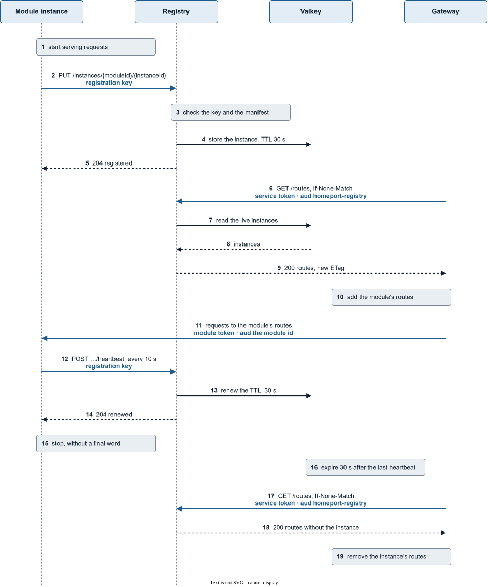

# Registering a module

A module becomes reachable through the gateway by registering at the registry.
With the SDK, `Homeport.Sdk`, that is configuration: `AddHomeportModule`
registers the instance once it has started and keeps it registered. A module
in another language implements the same protocol; it is specified in the
[module contract](../reference/module-contract/README.md#registration-and-heartbeat).

## Configure it

| Setting | Environment variable | Meaning |
|---|---|---|
| `Homeport:Registry:Url` | `Homeport__Registry__Url` | The registry, such as `http://registry` |
| `Homeport:Registry:Key` | `Homeport__Registry__Key` | The module's registration key, a secret from the operator |
| `Homeport:Registry:InstanceAddress` | `Homeport__Registry__InstanceAddress` | Where the gateway reaches this instance, such as `http://contracts-1:8080` |

Without `Url`, the module does not register and logs a warning; the gateway
never routes to it. That is how a module runs on its own, in a test for
example. With `Url` but without `Key` or an absolute `InstanceAddress`, the
module refuses to start.

In the AppHost, give the module a key parameter and its own endpoint as
address. Echo is the reference, in `src/Aspire/Homeport.Aspire.AppHost/Program.cs`:

```csharp
var contracts = builder.AddProject<Projects.Homeport_Modules_Contracts_Api>("contracts")
    .WithEnvironment("Homeport__Registry__Url", "http://registry")
    .WithEnvironment("Homeport__Registry__Key", contractsRegistrationKey)
    .WithReference(registry);
contracts.WithEnvironment("Homeport__Registry__InstanceAddress", contracts.GetEndpoint("http"));
```

The registry needs the same key under the module id; see
[the registry](../operators/registry.md#registration-keys).

## What happens

An instance of a module from its start to its stop. The diagram shows one
instance and no error path; every arrow that carries a credential is drawn
bold and names it.



1. The instance starts and waits until it serves requests.
2. It registers with `PUT /instances/{moduleId}/{instanceId}`, sending its
   manifest and its address, with its **registration key** as bearer token.
   Each instance chooses an id of its own at start, so instances of one
   module never replace each other.
3. The registry checks the key against the module id and the manifest
   against the module contract.
4. The registry stores the instance in Valkey, for 30 s.
5. The registry answers `204`.
6. Every 5 s the gateway reads `GET /routes` from the registry, with a
   **service token** for the audience `homeport-registry` and the `ETag` of
   its last read in `If-None-Match`. While nothing changed, the registry
   answers `304` in step 9 and the gateway keeps its table.
7. The registry reads the live instances from Valkey.
8. Valkey returns them, the new instance among them.
9. The registry answers with the route table and a new `ETag`.
10. The gateway adds the routes the instance declares to its table.
11. From now on the gateway forwards requests to those routes to the
    instance, with a **module token** for the module id
    ([the module token](module-token.md)).
12. Every 10 s the instance sends a heartbeat,
    `POST /instances/{moduleId}/{instanceId}/heartbeat`, with its
    **registration key**.
13. The registry renews the instance in Valkey for another 30 s.
14. The registry answers `204`.
15. The instance stops. It does not unregister.
16. Valkey drops the instance 30 s after its last heartbeat.
17. At its next poll, at most 5 s later, the gateway reads the routes with
    its `ETag`.
18. The registry answers with a route table without the instance, and a new
    `ETag`.
19. The gateway stops routing to the instance. A route no other instance
    declares leaves its table.

When the registry answers a heartbeat with `404` — it was down for longer
than 30 s, or Valkey lost the instance — the instance registers again on its
own, from step 2.

The registry checks the manifest against the module contract, not the SDK.
When it refuses the registration, the module logs the reason at Error and
stops with exit code 1, because it would run without ever being routed to:

| Answer | Reason | Log names |
|---|---|---|
| `401` | Unknown module id, or a wrong key | the status |
| `422` | The manifest breaks the module contract | every field and its message, such as `contractVersion: Contract version 99 is not supported; supported versions: 1.` |

A registry that cannot be reached is not a refusal. The module logs a
warning and tries again every 10 s.

## Several instances

Start as many instances as you need, each with its own `InstanceAddress`.
The gateway sends each request to one of the instances that declare its
route. Instances that register the same address, such as compose replicas
behind one service name, count as one: the network in front of them
distributes the requests, not the gateway.

An instance that stops without a final word keeps receiving requests until
it is dropped, up to 35 s. The gateway answers those with `502`
[`module-unreachable`](../reference/problems/module-unreachable.md).

## Rolling update

Roll out a new version instance by instance. The routes follow the instances
that declare them:

- A route both versions declare goes to every instance of either version.
  Where they declare it with different attributes — scope, meter, quantity —
  those of the instance with the highest `version` apply.
- A route only the new version declares goes only to its instances.
- A route only the old version declares disappears once its last instance
  is dropped.

No step needs the gateway or the registry to be touched.

## Two major versions side by side

A breaking change is a new major version under the same module id: `/v2/…`
next to `/v1/…`. Either deploy one build that declares both, or keep the old
build running for `/v1/…` next to the new one declaring `/v2/…`. Each route
goes only to the instances that declare it, so callers move to `/v2/…` when
they are ready, and `/v1/…` disappears with the last instance that declares
it.
