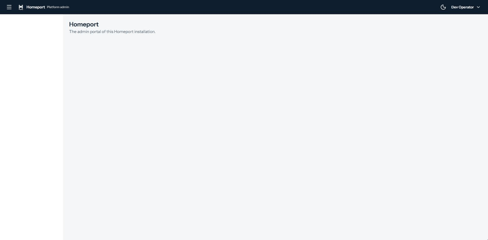
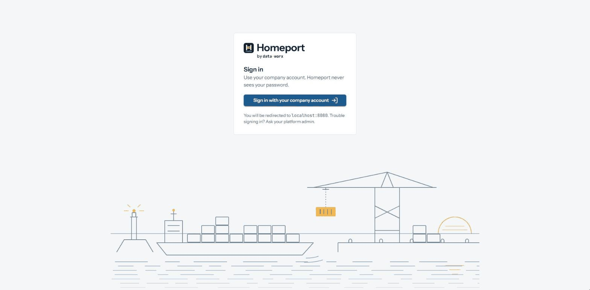

# The admin portal

The admin portal is where you, the operator, manage Homeport in a browser
([ADR-0020](../architecture/adr/0020-the-operator-as-a-caller.md)). You sign
in at your own identity provider; the portal never sees your password. It is
a Blazor Server application, so your tokens stay on its server and never
reach the browser.

So far the portal is its shell: you sign in, see who you are signed in as,
and sign out. Its pages for tenants, plans, clients, modules, usage and the
audit log follow, each with its own entry in the navigation.



## Signing in



1. A request from a browser without a session lands on the portal's sign-in
   page, not at the identity provider. It names the provider's host, so you
   know where you are sent.
2. Its button sends you to the provider with authorization code and PKCE
   (`S256`). The code comes back in the query of the redirect.
3. The portal exchanges the code for tokens from its server, as a
   confidential client, and keeps your session in a cookie.
4. Every page requires the claim that grants access, such as `roles` with
   `homeport-admin`. The claim may hold a list; one value must match. A user
   the provider knows but who lacks the claim gets the *access denied* page,
   with a button to sign in with another account. There is one role and no
   finer permissions.

*Sign out*, in the menu under your name, ends the session at the portal and
at the provider, and returns to the sign-in page.

## Configuration

| Setting | Environment variable | Default | Meaning |
|---|---|---|---|
| `SignIn:Authority` | `SignIn__Authority` | — | The issuer of your tokens. The portal reads the provider's metadata at `<authority>/.well-known/openid-configuration` |
| `SignIn:ClientId` | `SignIn__ClientId` | — | The portal's client id at the provider |
| `SignIn:ClientSecret` | `SignIn__ClientSecret` | — | The secret of that client |
| `SignIn:ClaimType` | `SignIn__ClaimType` | `roles` | The type of the claim that grants access |
| `SignIn:ClaimValue` | `SignIn__ClaimValue` | `homeport-admin` | The value that claim must carry |
| `SignIn:NameClaim` | `SignIn__NameClaim` | `name` | The claim your display name is taken from, shown in the app bar |
| `SignIn:RequireHttpsMetadata` | `SignIn__RequireHttpsMetadata` | `true` | Whether the metadata must be fetched over HTTPS. Turn it off only for a development provider without TLS |
| `TrustedProxies:Proxies:0`, … | `TrustedProxies__Proxies__0`, … | — | The reverse proxies whose forwarded headers the portal applies; see [below](#tls-and-the-reverse-proxy) |
| `TrustedProxies:Networks:0`, … | `TrustedProxies__Networks__0`, … | — | The same, as networks in CIDR notation |

The portal does not start without an authority, a client id and a secret.
Its start is logged at Information with the authority, the client id, the
claim, the name claim and the trusted proxies, never with the secret.

Use the same claim as the gateway's admin API, `AdminApi:ClaimType` and
`AdminApi:ClaimValue` (see [the admin API](admin-api.md)): the portal lets
you in, the gateway lets your requests through, and both should agree on
who is an operator.

## The client at your identity provider

Register the portal as a confidential client that uses authorization code:

- **Redirect URI** `https://<portal address>/signin-oidc`, and **post-logout
  redirect URI** `https://<portal address>/signout-callback-oidc`, where the
  portal address is the one your browser opens.
- **PKCE** with `S256`, if the provider lets you require it.
- **Scopes** `openid` and `profile`, which the portal asks for.
- **Claims in the ID token**: the subject, the display name in
  `SignIn:NameClaim`, and the claim that grants access. Many providers put
  roles into the access token only; map them into the ID token too, because
  the portal decides on the ID token.
- **Audience of the access token**: the one `AdminApi:Audience` names, so
  the gateway accepts the token the portal will call the admin API with.

Give the claim only to the people who operate Homeport.

## TLS and the reverse proxy

The portal signs in over HTTPS only. A sign-in that would come back over
plain HTTP is not started: the portal shows the sign-in page with *Sign-in
needs HTTPS* and logs a warning. Its cookies are `Secure` and `HttpOnly`,
and `SameSite=Lax` or stricter, so a browser would not send them over HTTP
anyway.

TLS ends at your reverse proxy. The proxy passes the scheme on in
`X-Forwarded-Proto`, and the portal applies it only from the proxies you
trust, configured as for the gateway (see
[the reverse proxy](reverse-proxy.md)). Without a trusted proxy, a request
that arrives over HTTP stays HTTP, whatever header it carries, and nobody
can sign in.

## Sessions

The session cookie is protected with ASP.NET Core's data protection keys.
The image keeps them inside the container, so a restart of the portal ends
every session and the operators sign in again. Run one replica: a second one
would not read the first one's cookies.

## Error pages

The portal answers a browser with HTML pages of its own: *access denied*,
*page not found*, and *something went wrong* for an unexpected error. Each
shows the trace id of the request. Give it to whoever reads the logs and
traces; it finds the request there (see [tracing](tracing.md)). The admin
API behind the gateway still answers with Problem Details.

## In the AppHost and the compose file

The AppHost runs the portal at <https://localhost:7400> with the
development certificate, against Keycloak. The realm holds the client
`portal` and the user `operator` with the role `homeport-admin`; its
password is the parameter `operator-password` (see
[running locally](running-locally.md#signing-in-to-the-portal)).

The compose file runs the image `homeport-portal` and publishes its plain
HTTP port, `PORTAL_PORT`, for your reverse proxy to terminate TLS in front
of. `PORTAL_ADDRESS` is the address your browser opens; the development
realm sends you back to it after signing in. The compose file sets no
trusted proxy: add your proxy as for the gateway, in an override file:

```yaml
services:
  portal:
    environment:
      TrustedProxies__Proxies__0: "10.0.0.5"
```

## What is logged

At Warning: a signed-in user without the claim that grants access, with the
claim they lack, and a sign-in refused over plain HTTP. Neither names the
user.
